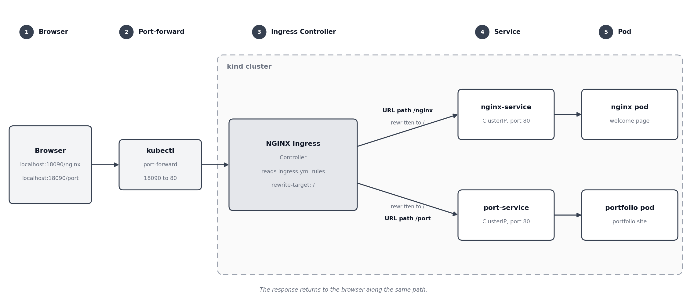

# Kubernetes Ingress Hands-On

## Use case

Two applications run in the same Kubernetes cluster (kind):

- nginx, which shows the default nginx welcome page
- portfolio, a personal portfolio website (image shubhamm18/portfolio:v1)

Instead of giving each application its own port, one Ingress is used as a single entry point. The URL path decides which application answers:

- /nginx is served by nginx-service
- /port is served by port-service

---

## Overall flow diagram



Read the diagram from left to right. A request to localhost:18090 goes through the port-forward to the NGINX Ingress Controller inside the cluster. The controller checks the URL path against the rules in ingress.yml, rewrites the path to /, and sends the request to the matching Service, which passes it to the pod.

- http://localhost:18090/nginx goes to nginx-service and then the nginx pod, which returns the nginx welcome page.
- http://localhost:18090/port goes to port-service and then the portfolio pod, which returns the portfolio website.

---

## app.yml

```yaml
apiVersion: apps/v1
kind: Deployment
metadata:
  name: nginx
spec:
  selector:
    matchLabels:
      app: nginx
  template:
    metadata:
      labels:
        app: nginx
    spec:
      containers:
        - name: nginx
          image: nginx:latest
          ports:
            - containerPort: 80
---
apiVersion: v1
kind: Service
metadata:
  name: nginx-service
spec:
  type: ClusterIP
  selector:
    app: nginx
  ports:
    - port: 80
      targetPort: 80
```

Explanation:

- The Deployment starts a pod running nginx and gives it the label app: nginx.
- The Service finds that pod through its selector (app: nginx). The label and the selector must match exactly.
- type: ClusterIP means the Service is reachable only inside the cluster. Users cannot open it directly, so every request must pass through the Ingress.
- port: 80 is the port of the Service. targetPort: 80 is the port the container listens on.

## my.yml

```yaml
apiVersion: apps/v1
kind: Deployment
metadata:
  name: portfolio
spec:
  selector:
    matchLabels:
      app: port
  template:
    metadata:
      labels:
        app: port
    spec:
      containers:
        - name: portfolio
          image: shubhamm18/portfolio:v1
          ports:
            - containerPort: 80
---
apiVersion: v1
kind: Service
metadata:
  name: port-service
spec:
  type: ClusterIP
  selector:
    app: port
  ports:
    - port: 80
      targetPort: 80
```

The portfolio application works the same way. Its pod has the label app: port, and port-service selects that label.

---

## ingress.yml

```yaml
apiVersion: networking.k8s.io/v1
kind: Ingress
metadata:
  name: app-ingress
  annotations:
    nginx.ingress.kubernetes.io/rewrite-target: /
spec:
  ingressClassName: nginx
  rules:
    - http:
        paths:
          - path: /nginx
            pathType: Prefix
            backend:
              service:
                name: nginx-service
                port:
                  number: 80
          - path: /port
            pathType: Prefix
            backend:
              service:
                name: port-service
                port:
                  number: 80
```

### Read it like a story

Picture an office building with two departments, nginx and portfolio. At the front desk sits a receptionist, the NGINX Ingress Controller. The file ingress.yml is the note stuck on the desk that tells the receptionist where to send each visitor.

Here is the same note with a comment on every important line:

```yaml
apiVersion: networking.k8s.io/v1
kind: Ingress                      # this is a note for the receptionist
metadata:
  name: app-ingress                # the name of the note
  annotations:
    nginx.ingress.kubernetes.io/rewrite-target: /   # take off the department label at the door
spec:
  ingressClassName: nginx          # this note is for the NGINX receptionist, not any other
  rules:
    - http:
        paths:
          - path: /nginx           # a visitor asks for /nginx
            pathType: Prefix       # and /nginx/anything counts too
            backend:
              service:
                name: nginx-service    # send them to the nginx department
                port:
                  number: 80           # and knock on its door number 80
          - path: /port            # a visitor asks for /port
            pathType: Prefix
            backend:
              service:
                name: port-service     # send them to the portfolio department
                port:
                  number: 80
```

In plain English, the whole note says:

- If someone asks for /nginx, send them to nginx-service on port 80.
- If someone asks for /port, send them to port-service on port 80.
- Before handing them over, change the path to /, because inside the departments the home page lives at /.

### Three things that trip people up

- The Service name in the note must match the real Service exactly. One wrong letter and the receptionist has nowhere to send the visitor.
- Prefix needs a capital P. Kubernetes rejects prefix and perfix.
- Port 80 is the port of the Service, not a NodePort. The Ingress never uses NodePort numbers.

---

## The annotation

```yaml
nginx.ingress.kubernetes.io/rewrite-target: /
```

The annotation has three parts:

- nginx.ingress.kubernetes.io is the prefix. It shows that the setting belongs to the NGINX Ingress Controller. A controller only reads annotations with its own prefix.
- rewrite-target is the name of the setting. It is a feature built into the NGINX Ingress Controller.
- The value / is the path that is sent to the application.

Why it is needed:

The applications serve their home page at /, not at /nginx or /port. The path /nginx is only used to choose the right application. With the rewrite:

- A request for /nginx reaches the nginx pod as /
- A request for /port reaches the portfolio pod as /

Without the rewrite, the pod would receive /nginx and return 404 because that page does not exist inside the application.

Kubernetes does not check annotation names. If the name is misspelled, nothing fails and the setting is silently ignored.

---

## Steps performed

### 1. Create the applications

```bash
kubectl apply -f app.yml
kubectl apply -f my.yml
kubectl get pods
kubectl get endpoints nginx-service port-service
```

Each Service must list a pod IP under endpoints. This confirms that the Service selector matches the pod label.

### 2. Create the Ingress

```bash
kubectl apply -f ingress.yml
kubectl get ingress
kubectl describe ingress app-ingress
```

The describe output shows both rules connected to pod IPs:

```
/nginx   nginx-service:80 (10.244.3.3:80)
/port    port-service:80 (10.244.2.4:80)
```

### 3. Install the Ingress Controller

An Ingress only contains rules. A controller must be running in the cluster to apply them. Checking showed that no controller was installed:

```bash
kubectl get pods -n ingress-nginx
```

Result: No resources found. This is also why the ADDRESS column was empty and Events showed none.

The NGINX Ingress Controller for kind was installed:

```bash
kubectl apply -f https://raw.githubusercontent.com/kubernetes/ingress-nginx/main/deploy/static/provider/kind/deploy.yaml
kubectl wait --namespace ingress-nginx \
  --for=condition=ready pod \
  --selector=app.kubernetes.io/component=controller \
  --timeout=120s
kubectl get pods -n ingress-nginx
```

The controller pod must show Running with 1/1 ready.

### 4. Open the applications

The controller runs inside the cluster, so a port-forward is used to reach it from the machine:

```bash
kubectl port-forward -n ingress-nginx svc/ingress-nginx-controller 18090:80
```

The format is LOCAL_PORT:SERVICE_PORT. Port 18090 was used because 8080 and 8081 were already in use on the machine. This terminal must stay open.

Test from a second terminal:

```bash
curl http://localhost:18090/nginx
curl http://localhost:18090/port
```

Open in the browser:

```
http://localhost:18090/nginx
http://localhost:18090/port
```

When the cluster runs on a remote server, localhost in the browser means the local computer. An SSH tunnel connects the two:

```bash
ssh -L 18090:localhost:18090 root@<server-ip>
```

---

## How a request flows

1. The browser requests /port.
2. The request reaches the NGINX Ingress Controller.
3. The controller finds the rule for /port, which points to port-service.
4. The rewrite changes the path to /.
5. The request is delivered to a portfolio pod.
6. The response returns the same way to the browser.

---

## Result

- One entry point serves both applications.
- /nginx opens the nginx welcome page.
- /port opens the portfolio application.
- Both Services are ClusterIP, so the Ingress is the only way in.

Note: because rewrite-target sends every request to /, an application that loads CSS or JavaScript from absolute paths such as /static/app.js may look unstyled when served under /port. The nginx welcome page has no such files, so it is not affected.
